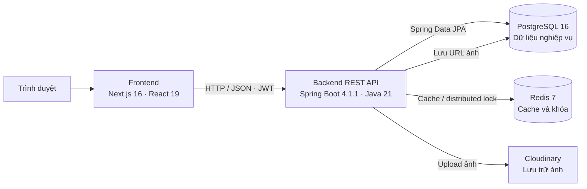

# System Architecture

## 1. Overview

TechStore là ứng dụng web bán hàng theo mô hình client–server, được chia thành frontend Next.js và backend Spring Boot. Backend cung cấp REST API, xử lý nghiệp vụ và truy cập dữ liệu; các dịch vụ lưu trữ được triển khai riêng.



Frontend hiện cấu hình API tại `http://localhost:8080/api/v1`; backend mặc định chạy cổng `8080`. PostgreSQL lưu dữ liệu bền vững, Redis được dùng cho cache và khóa phân tán, còn nội dung ảnh được lưu ở Cloudinary.

## 2. Module Breakdown

### Frontend

Frontend nằm trong `techstore_frontend`, sử dụng Next.js App Router, React, TypeScript và Tailwind CSS.

- `app/`: các trang đăng nhập, đăng ký, trang chủ và giao diện quản trị.
- `components/`: các thành phần giao diện dùng chung, biểu mẫu sản phẩm/danh mục và thành phần xác thực.
- `services/`: các hàm gọi API cho auth, user, product, category, specification và image.
- `lib/axios.tsx`: Axios client chung, cấu hình base URL và gắn access token cho request không phải public.
- `lib/validations/`: schema kiểm tra dữ liệu biểu mẫu.

### Backend

Backend nằm trong `techstore_backend`, sử dụng Spring Boot, Spring Web, Spring Security, Spring Data JPA và Spring Data Redis. Các module được tổ chức theo nghiệp vụ, thường gồm controller, DTO, entity, repository và service:

| Module | Trách nhiệm |
|---|---|
| `auth` | Đăng nhập, xác thực token, làm mới token, đăng xuất và lưu token đã vô hiệu hóa |
| `user` | Tài khoản, phân loại người dùng và voucher đã thu thập |
| `role`, `permission` | Vai trò và quyền truy cập |
| `product`, `category`, `specification`, `image` | Danh mục sản phẩm, thông số kỹ thuật và ảnh |
| `campaign`, `rule`, `voucher` | Chiến dịch, điều kiện/chiến lược khuyến mãi và voucher |
| `order` | Đơn hàng, chi tiết đơn, tính tổng tiền và áp dụng voucher |
| `shared` | Cấu hình dùng chung, xử lý lỗi và định dạng phản hồi API |

Luồng REST phổ biến đi qua `Controller → Service → Repository → PostgreSQL`. Controller nhận request và trả DTO; service thực hiện nghiệp vụ; repository thao tác entity qua JPA. Lỗi nghiệp vụ được chuyển thành phản hồi API tập trung bởi `GlobalException`.

### Hạ tầng và tích hợp

- **PostgreSQL:** lưu dữ liệu nghiệp vụ và quan hệ giữa các entity.
- **Redis:** cấu hình cache với TTL mặc định 5 phút; `DistributedLockService` dùng khóa Redis khi tạo đơn có voucher để tránh tranh chấp số lượng.
- **Cloudinary:** nhận file ảnh; backend lưu URL ảnh trả về vào PostgreSQL.
- **JWT:** Spring Security xác thực request; các API yêu cầu đăng nhập cần access token, ngoại trừ các endpoint công khai đã cấu hình như đăng ký và một số endpoint auth.

## 3. Luồng xử lý chính

### 3.1 Đăng ký và đăng nhập

1. Người dùng gửi thông tin qua giao diện Next.js.
2. Frontend gọi REST API qua Axios client.
3. Backend kiểm tra thông tin và tìm tài khoản qua service/repository; mật khẩu được kiểm tra bằng BCrypt.
4. Khi đăng nhập thành công, backend phát hành access token và refresh token. Frontend lưu access token để gắn vào request; backend thiết lập refresh token trong cookie HTTP-only.
5. Backend xác thực JWT trên các request cần đăng nhập. Khi đăng xuất hoặc làm mới token, token cũ được ghi nhận trong `invalidated_token`.

### 3.2 Quản lý danh mục và sản phẩm

1. Người quản trị thao tác trên các trang quản trị của frontend.
2. Frontend gửi request tới API product/category/specification.
3. Backend kiểm tra quyền và dữ liệu, sau đó lưu hoặc truy vấn qua Spring Data JPA.
4. Thông số sản phẩm được gắn với product và specification; danh mục có thể chứa danh mục con.

### 3.3 Tải ảnh sản phẩm

1. Frontend gửi multipart request tới API ảnh, kèm mã sản phẩm.
2. Backend kiểm tra sản phẩm tồn tại và tải file lên Cloudinary.
3. Backend lưu URL ảnh cùng quan hệ tới sản phẩm trong PostgreSQL, rồi trả thông tin ảnh cho frontend.

### 3.4 Tạo đơn hàng và sử dụng voucher

1. Service lấy người dùng hiện tại từ thông tin xác thực, đọc sản phẩm và tính tổng tiền.
2. Nếu request có voucher, backend lấy khóa Redis theo mã voucher, kiểm tra trạng thái voucher, số lượng còn lại và quyền sở hữu/trạng thái voucher của người dùng.
3. Rule Engine kiểm tra điều kiện áp dụng và chọn chiến lược giảm giá phù hợp.
4. Trong transaction, backend lưu đơn hàng và các dòng chi tiết, tính giá cuối cùng, cập nhật trạng thái/khả dụng voucher; cuối luồng giải phóng khóa Redis.
5. Nếu không sử dụng voucher, service tạo đơn với giá cuối cùng bằng tổng giá sản phẩm.

Các endpoint đơn hàng được cung cấp tại `/api/v1/orders`: `POST` để tạo đơn, `GET` để liệt kê, `GET /{id}` để xem chi tiết và `GET /filter?startDate=YYYY-MM-DD&endDate=YYYY-MM-DD` để lọc theo ngày.

## 4. Cấu trúc Mono Repo

```text
techstore/
├── docs/
│   ├── architecture.md
│   └── database.md
├── techstore_backend/
│   ├── src/main/java/com/techstore/techstore_backend/
│   │   ├── modules/          # Các module nghiệp vụ
│   │   ├── shared/           # Cấu hình, exception, response dùng chung
│   │   └── TechstoreBackendApplication.java
│   ├── src/main/resources/
│   │   └── application.yaml
│   └── pom.xml
├── techstore_frontend/
│   ├── app/                  # Trang Next.js App Router
│   ├── components/           # Thành phần giao diện
│   ├── hooks/                # React hooks dùng chung
│   ├── lib/                  # Axios, tiện ích và validation
│   ├── services/             # Client gọi API backend
│   └── package.json
├── .env.example
└── docker-compose.yaml       # PostgreSQL và Redis
```

Frontend và backend là hai ứng dụng riêng trong cùng repository, có thể cài đặt, chạy và build độc lập. Trong frontend, `hooks/` chứa các React hooks tái sử dụng cho giao diện, hiện có `useCategory` và `useSpecification`. Thư mục `docs` chứa tài liệu kiến trúc và cơ sở dữ liệu.

## 5. Môi trường

| Thành phần | Phiên bản/cổng mặc định | Cách cấu hình |
|---|---|---|
| Frontend | Next.js 16, React 19; cổng phát triển mặc định `3000` | `techstore_frontend/package.json` |
| Backend | Java 21, Spring Boot 4.1; cổng `8080` | `techstore_backend/src/main/resources/application.yaml` |
| PostgreSQL | PostgreSQL 16; container dùng cổng `5432` | `.env` theo mẫu `.env.example`; host port do `POSTGRES_PORT` |
| Redis | Redis 7; container dùng cổng `6379` | `.env` theo mẫu `.env.example`; host port do `REDIS_PORT` |
| Cloudinary | Dịch vụ bên ngoài | Cấu hình bằng các biến `CLOUDINARY_*` |

`docker-compose.yaml` hiện bật PostgreSQL và Redis. Khai báo service backend trong Compose đang được comment, vì vậy backend và frontend cần được khởi chạy riêng khi phát triển cục bộ. Frontend hiện gọi backend tại `http://localhost:8080/api/v1`; nếu thay đổi địa chỉ hoặc triển khai môi trường khác, cần cập nhật cấu hình API tương ứng.

Các giá trị cấu hình thật như mật khẩu cơ sở dữ liệu, JWT secret và thông tin Cloudinary cần được cung cấp qua biến môi trường hoặc secret store của môi trường triển khai; không lưu secret thật vào repository.
