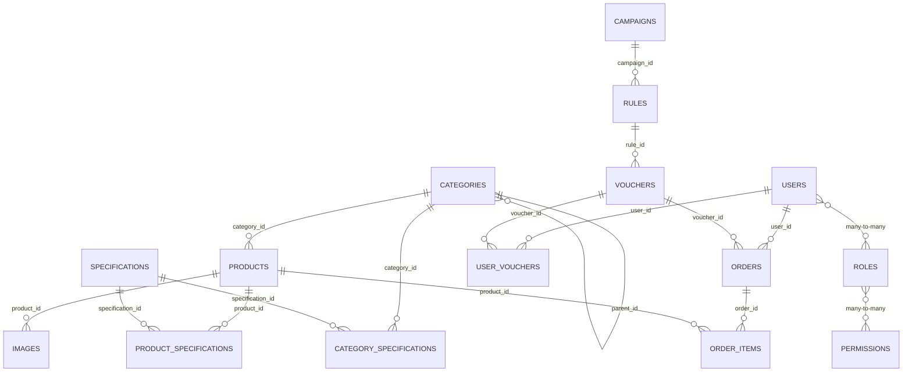

# Tài liệu cơ sở dữ liệu

## 1. Tổng quan

Hệ thống sử dụng PostgreSQL với 17 bảng chính, tổ chức xoay quanh 3 nhóm nghiệp vụ:

- **User:** Quản lý tài khoản và phân loại khách hàng.
- **Campaign & Voucher:** Quản lý chiến dịch, quy tắc khuyến mãi (rule) và mã giảm giá.
- **Order & Voucher distribution:** Quản lý đơn hàng và lịch sử voucher người dùng đã thu thập.

| Thành phần | Công nghệ | Mục đích |
|---|---|---|
| Cơ sở dữ liệu quan hệ | PostgreSQL 16 | Lưu tài khoản, sản phẩm, đơn hàng, khuyến mãi và dữ liệu liên quan |
| Lưu trữ tạm | Redis 7 | Dữ liệu phục vụ cache/khóa phân tán; không thuộc schema PostgreSQL |
| ORM | Spring Data JPA / Hibernate | Ánh xạ entity và tạo/cập nhật schema |
| Ảnh sản phẩm | Cloudinary | Lưu ảnh bên ngoài; cơ sở dữ liệu chỉ lưu URL ảnh |

Schema được tạo/cập nhật từ entity nhờ cấu hình `spring.jpa.hibernate.ddl-auto: update`. Tên bảng được khai báo rõ trong entity được liệt kê bên dưới; với entity không khai báo `@Table`, tên bảng/cột theo quy tắc đặt tên của Hibernate. Kiểu SQL cụ thể có thể thay đổi theo dialect và phiên bản Hibernate.

## 2. Sơ đồ quan hệ (ERD)



Hai quan hệ nhiều-nhiều giữa `users`–`roles` và `roles`–`permissions` được khai báo bằng `@ManyToMany`; Hibernate quản lý các bảng trung gian tương ứng theo naming strategy. Tên bảng/cột trung gian không được khai báo tường minh trong entity.

## 3. Danh mục bảng

Quy ước: `PK` là khóa chính, `FK` là khóa ngoại. Các trường ghi “có thể NULL” không được entity đánh dấu `nullable = false`; constraint thực tế còn phụ thuộc schema do Hibernate tạo và cấu hình triển khai.

### 3.1 Tài khoản và phân quyền

#### `users`

Thông tin người dùng.

| Cột | Ý nghĩa |
|---|---|
| `id` (PK) | Mã người dùng, tự tăng |
| `username` | Tên đăng nhập, bắt buộc và duy nhất |
| `password` | Mật khẩu đã mã hóa, bắt buộc |
| `name` | Tên hiển thị, có thể NULL |
| `phone` | Số điện thoại, có thể NULL |
| `user_type` | Hạng/nhóm người dùng (`UserType`), mặc định `NORMAL` |
| Quan hệ nhiều-nhiều với `roles` | Vai trò được cấp cho người dùng |

Các giá trị `UserType`: `ALL`, `NORMAL`, `BRONZE`, `SILVER`, `GOLD`.

#### `roles`

| Cột | Ý nghĩa |
|---|---|
| `name` (PK) | Tên vai trò |
| `description` | Mô tả, có thể NULL |
| Quan hệ nhiều-nhiều với `permissions` | Các quyền thuộc vai trò |

#### `permissions`

| Cột | Ý nghĩa |
|---|---|
| `name` (PK) | Tên quyền |
| `description` | Mô tả, có thể NULL |

### 3.2 Danh mục và sản phẩm

#### `categories`

| Cột | Ý nghĩa |
|---|---|
| `id` (PK) | Mã danh mục, tự tăng |
| `name` | Tên danh mục, bắt buộc |
| `parent_id` (FK → `categories.id`) | Danh mục cha, có thể NULL; hỗ trợ cấu trúc cây |

#### `products`

| Cột | Ý nghĩa |
|---|---|
| `id` (PK) | Mã sản phẩm, tự tăng |
| `name` | Tên sản phẩm |
| `price` | Giá sản phẩm (`BigDecimal`) |
| `quantity` | Số lượng tồn kho |
| `is_active` | Trạng thái hoạt động |
| `created_at`, `updated_at` | Thời điểm tạo/cập nhật |
| `category_id` (FK → `categories.id`) | Danh mục của sản phẩm, có thể NULL |

#### `images`

| Cột | Ý nghĩa |
|---|---|
| `id` (PK) | Mã ảnh, tự tăng |
| `url_image` | URL ảnh trên dịch vụ lưu trữ bên ngoài |
| `product_id` (FK → `products.id`) | Sản phẩm liên quan, có thể NULL |

#### `specifications`

| Cột | Ý nghĩa |
|---|---|
| `id` (PK) | Mã thông số, tự tăng |
| `name` | Tên thông số |
| `unit` | Đơn vị đo, có thể NULL |

#### `category_specifications`

Liên kết danh mục với các thông số được áp dụng cho danh mục đó.

| Cột | Ý nghĩa |
|---|---|
| `id` (PK) | Mã liên kết, tự tăng |
| `category_id` (FK → `categories.id`) | Danh mục, có thể NULL theo mapping hiện tại |
| `specification_id` (FK → `specifications.id`) | Thông số, có thể NULL theo mapping hiện tại |

#### `product_specifications`

Lưu giá trị thông số cụ thể của sản phẩm.

| Cột | Ý nghĩa |
|---|---|
| `id` (PK) | Mã bản ghi, tự tăng |
| `product_id` (FK → `products.id`) | Sản phẩm, bắt buộc |
| `specification_id` (FK → `specifications.id`) | Thông số, bắt buộc |
| `value` | Giá trị thông số, có thể NULL |

### 3.3 Đơn hàng

#### `orders`

| Cột | Ý nghĩa |
|---|---|
| `id` (PK) | Mã đơn hàng, tự tăng |
| `user_id` (FK → `users.id`) | Người đặt, bắt buộc |
| `voucher_id` (FK → `vouchers.id`) | Voucher áp dụng, bắt buộc theo mapping hiện tại |
| `total_price` | Tổng giá trước giảm giá (`numeric(15,2)`), bắt buộc |
| `final_price` | Giá cuối cùng (`numeric(15,2)`), bắt buộc |
| `status` | Trạng thái đơn (`OrderStatus`), mặc định `SUCCESS` |
| `is_deleted` | Cờ xóa mềm, mặc định `false` |
| `created_at` | Thời điểm tạo đơn, bắt buộc |

Các giá trị `OrderStatus`: `SUCCESS`, `CANCEL`.

#### `order_items`

| Cột | Ý nghĩa |
|---|---|
| `id` (PK) | Mã dòng đơn hàng, tự tăng |
| `order_id` (FK → `orders.id`) | Đơn hàng, bắt buộc |
| `product_id` (FK → `products.id`) | Sản phẩm, bắt buộc |
| `quantity` | Số lượng đặt, bắt buộc |
| `price` | Giá sản phẩm tại dòng đơn (`numeric(15,2)`), bắt buộc |

### 3.4 Khuyến mãi và voucher

#### `campaigns`

| Cột | Ý nghĩa |   
|---|---|
| `id` (PK) | Mã chiến dịch, tự tăng |
| `name` | Tên chiến dịch, bắt buộc |
| `status` | Trạng thái (`CampaignStatus`), mặc định `UPCOMING` |
| `budget` | Ngân sách (`BigDecimal`), bắt buộc |
| `start_time`, `end_time` | Thời gian bắt đầu/kết thúc, bắt buộc |
| `created_at`, `updated_at` | Thời điểm tạo/cập nhật, do Hibernate quản lý |
| `is_deleted` | Cờ xóa mềm, mặc định `false` |

Các giá trị `CampaignStatus`: `ACTIVE`, `UPCOMING`, `END`.

#### `rules`

| Cột | Ý nghĩa |
|---|---|
| `id` (PK) | Mã quy tắc, tự tăng |
| `name` | Tên quy tắc, bắt buộc |
| `campaign_id` (FK → `campaigns.id`) | Chiến dịch, bắt buộc |
| `rule_type` | Loại quy tắc (`RuleType`), bắt buộc |
| `user_type` | Nhóm người dùng áp dụng (`UserType`), bắt buộc |
| `value` | Giá trị giảm giá, có thể NULL |
| `max_discount_value` | Mức giảm tối đa, có thể NULL |
| `min_order_value` | Giá trị đơn hàng tối thiểu, có thể NULL |
| `payload` | Tham số bổ sung dạng JSONB, có thể NULL |
| `start_time`, `end_time` | Thời gian hiệu lực, bắt buộc |
| `status` | Trạng thái (`RuleStatus`), mặc định `ACTIVE`; hiện được JPA lưu theo ordinal (số thứ tự enum) |
| `is_deleted` | Cờ xóa mềm, mặc định `false` |
| `created_at` | Thời điểm tạo, bắt buộc |

Các giá trị `RuleType`: `BUY_X_GET_Y`, `PERCENTAGE`, `FIXED`, `TIERED`.  
Các giá trị `RuleStatus`: `ACTIVE`, `INACTIVE`.

#### `vouchers`

| Cột | Ý nghĩa |
|---|---|
| `id` (PK) | Mã voucher, tự tăng |
| `rule_id` (FK → `rules.id`) | Quy tắc áp dụng, bắt buộc |
| `quantity` | Tổng số lượng voucher, bắt buộc |
| `quantity_remain` | Số lượng còn lại, bắt buộc |
| `limit_client` | Giới hạn sử dụng cho khách hàng, bắt buộc |
| `status` | Trạng thái (`VoucherStatus`), mặc định `ACTIVE`; hiện được JPA lưu theo ordinal (số thứ tự enum) |

Các giá trị `VoucherStatus`: `ACTIVE`, `DISABLED`, `USED`.

#### `user_vouchers`

Voucher được cấp/thu thập bởi người dùng.

| Cột | Ý nghĩa |
|---|---|
| `id` (PK) | Mã bản ghi, tự tăng |
| `user_id` (FK → `users.id`) | Người dùng, bắt buộc |
| `voucher_id` (FK → `vouchers.id`) | Voucher, bắt buộc |
| `collected_at` | Thời điểm thu thập, tự ghi khi tạo |
| `status` | Trạng thái (`UserVoucherStatus`), mặc định `UNUSED` |

Các giá trị `UserVoucherStatus`: `USED`, `UNUSED`.

### 3.5 Xác thực

#### `invalidated_token`

Danh sách token đã bị vô hiệu hóa.

| Cột | Ý nghĩa |
|---|---|
| `id` (PK) | Định danh token |
| `expiration_time` | Thời điểm token hết hạn |

## 4. Kiểu dữ liệu thường dùng

Kiểu dưới đây là ánh xạ khái quát từ Java sang PostgreSQL; schema được Hibernate sinh ra mới là nguồn xác định cuối cùng.

| Kiểu Java | Kiểu PostgreSQL thường gặp |
|---|---|
| `Integer` | `integer` |
| `String` | `varchar` |
| `BigDecimal` | `numeric` (các cột giá/tiền có khai báo `precision = 15, scale = 2`) |
| `Boolean` / `boolean` | `boolean` |
| `LocalDateTime` / `Date` | `timestamp` |
| `Map<String, Object>` có `@JdbcTypeCode(SqlTypes.JSON)` | `jsonb` |
| Enum được khai báo `EnumType.STRING` | `varchar` chứa tên enum |
| Enum không chỉ định `@Enumerated(EnumType.STRING)` | Mặc định JPA là ordinal (`integer`); hiện áp dụng cho `rules.status` và `vouchers.status` |

## 5. Cấu hình kết nối và khởi tạo

### PostgreSQL

Thiết lập kết nối của Spring Boot nằm trong `techstore_backend/src/main/resources/application.yaml`:

- URL mặc định: `jdbc:postgresql://localhost:5431/tech_store`; có thể ghi đè bằng `SPRING_DATASOURCE_URL`.
- Tên đăng nhập và mật khẩu lấy từ `POSTGRES_USER` và `POSTGRES_PASSWORD`.
- `docker-compose.yaml` chạy PostgreSQL 16 và ánh xạ cổng máy chủ `${POSTGRES_PORT}` tới cổng `5432` trong container.
- Các biến cấu hình container được khai báo trong `.env.example`. Hãy tạo `.env` với giá trị phù hợp cho môi trường của bạn; không đưa thông tin xác thực thật vào tài liệu hoặc Git.

Lưu ý: giá trị mặc định kết nối trong cấu hình ứng dụng không tự động đồng bộ với `POSTGRES_DB`/`POSTGRES_PORT` của Docker Compose. Khi chạy bằng Compose, cần cấu hình các biến môi trường để URL, database, user và port khớp nhau.

### Hibernate và thay đổi schema

- `ddl-auto: update` tiện cho phát triển, nhưng không thay thế quy trình migration có kiểm soát ở production.
- Khi triển khai production, nên dùng công cụ migration như Flyway hoặc Liquibase để quản lý thay đổi schema theo phiên bản.
- `show-sql: true` bật log câu SQL; cân nhắc tắt hoặc cấu hình log phù hợp khi triển khai.

### Redis

Redis được chạy riêng trong Docker Compose, sử dụng cổng máy chủ `${REDIS_PORT}` ánh xạ tới `6379` trong container. Redis không phải một phần của ERD PostgreSQL.

## 6. Mô tả quan hệ

- **Danh mục – sản phẩm:** một danh mục có thể chứa nhiều sản phẩm; sản phẩm tham chiếu danh mục qua `products.category_id`. Danh mục có thể có danh mục cha thông qua `categories.parent_id`.
- **Danh mục – thông số:** `category_specifications` liên kết danh mục với những thông số có thể áp dụng cho danh mục.
- **Sản phẩm – thông số:** `product_specifications` lưu giá trị của từng thông số trên sản phẩm. Bảng này cho phép tái sử dụng một thông số cho nhiều sản phẩm.
- **Sản phẩm – ảnh:** một sản phẩm có thể có nhiều ảnh; mỗi ảnh tham chiếu sản phẩm qua `images.product_id`. URL ảnh trỏ tới Cloudinary, không lưu dữ liệu ảnh nhị phân trong PostgreSQL.
- **Người dùng – vai trò – quyền:** người dùng có thể có nhiều vai trò và một vai trò có thể được gán cho nhiều người dùng. Tương tự, vai trò có thể chứa nhiều quyền. Đây là hai quan hệ nhiều-nhiều do JPA quản lý qua bảng liên kết.
- **Người dùng – đơn hàng:** một người dùng có thể tạo nhiều đơn hàng; mỗi đơn hàng thuộc về một người dùng.
- **Đơn hàng – sản phẩm:** `order_items` là bảng chi tiết đơn hàng. Mỗi dòng gắn một đơn hàng với một sản phẩm, đồng thời lưu số lượng và giá tại thời điểm đặt hàng.
- **Chiến dịch – quy tắc – voucher:** một chiến dịch có thể có nhiều quy tắc; mỗi quy tắc thuộc một chiến dịch. Một quy tắc có thể được dùng để phát hành nhiều voucher.
- **Người dùng – voucher:** `user_vouchers` ghi nhận voucher được thu thập bởi người dùng cùng thời điểm thu thập và trạng thái sử dụng.
- **Đơn hàng – voucher:** mỗi đơn hàng tham chiếu voucher qua `orders.voucher_id`; mapping hiện tại yêu cầu trường này không NULL.
- **Token bị vô hiệu hóa:** `invalidated_token` lưu định danh và thời điểm hết hạn token; entity hiện không khai báo quan hệ khóa ngoại tới bảng nghiệp vụ khác.

Các mối quan hệ trên phản ánh mapping JPA hiện tại. Những constraint như tính duy nhất của một cặp liên kết, cascade xóa hoặc tính bắt buộc chưa được khai báo trong entity không được giả định trong tài liệu này.

## 7. Source (DBML)

DBML dưới đây mô tả schema nghiệp vụ để xem hoặc dựng sơ đồ bằng công cụ tương thích DBML. Các bảng trung gian của quan hệ nhiều-nhiều được thể hiện theo tên thông dụng dựa trên naming strategy mặc định; tên thực tế có thể khác nếu Hibernate được cấu hình naming strategy tùy chỉnh.

```dbml
Table users {
  id integer [pk, increment]
  username varchar [not null, unique]
  password varchar [not null]
  name varchar
  phone varchar
  user_type varchar
}

Table roles {
  name varchar [pk]
  description varchar
}

Table permissions {
  name varchar [pk]
  description varchar
}

Table user_roles {
  user_id integer [not null]
  roles_name varchar [not null]

  indexes {
    (user_id, roles_name) [pk]
  }
}

Table role_permissions {
  roles_name varchar [not null]
  permissions_name varchar [not null]

  indexes {
    (roles_name, permissions_name) [pk]
  }
}

Table categories {
  id integer [pk, increment]
  name varchar [not null]
  parent_id integer
}

Table products {
  id integer [pk, increment]
  name varchar
  price numeric
  quantity integer
  is_active boolean
  created_at timestamp
  updated_at timestamp
  category_id integer
}

Table images {
  id integer [pk, increment]
  url_image varchar
  product_id integer
}

Table specifications {
  id integer [pk, increment]
  name varchar
  unit varchar
}

Table category_specifications {
  id integer [pk, increment]
  category_id integer
  specification_id integer
}

Table product_specifications {
  id integer [pk, increment]
  product_id integer [not null]
  specification_id integer [not null]
  value varchar
}

Table orders {
  id integer [pk, increment]
  user_id integer [not null]
  voucher_id integer [not null]
  total_price numeric(15, 2) [not null]
  final_price numeric(15, 2) [not null]
  status varchar [not null]
  is_deleted boolean
  created_at timestamp [not null]
}

Table order_items {
  id integer [pk, increment]
  product_id integer [not null]
  order_id integer [not null]
  quantity integer [not null]
  price numeric(15, 2) [not null]
}

Table campaigns {
  id integer [pk, increment]
  name varchar [not null]
  status varchar [not null]
  budget numeric [not null]
  start_time timestamp [not null]
  end_time timestamp [not null]
  created_at timestamp [not null]
  updated_at timestamp [not null]
  is_deleted boolean [not null]
}

Table rules {
  id integer [pk, increment]
  name varchar [not null]
  campaign_id integer [not null]
  rule_type varchar [not null]
  user_type varchar [not null]
  value numeric(15, 2)
  max_discount_value numeric(15, 2)
  min_order_value numeric(15, 2)
  payload jsonb
  start_time timestamp [not null]
  end_time timestamp [not null]
  status integer [not null]
  is_deleted boolean [not null]
  created_at timestamp [not null]
}

Table vouchers {
  id integer [pk, increment]
  rule_id integer [not null]
  quantity integer [not null]
  quantity_remain integer [not null]
  limit_client integer [not null]
  status integer [not null]
}

Table user_vouchers {
  id integer [pk, increment]
  user_id integer [not null]
  voucher_id integer [not null]
  collected_at timestamp [not null]
  status varchar(20) [not null]
}

Table invalidated_token {
  id varchar [pk]
  expiration_time timestamp
}

Ref: categories.parent_id > categories.id
Ref: products.category_id > categories.id
Ref: images.product_id > products.id
Ref: category_specifications.category_id > categories.id
Ref: category_specifications.specification_id > specifications.id
Ref: product_specifications.product_id > products.id
Ref: product_specifications.specification_id > specifications.id
Ref: user_roles.user_id > users.id
Ref: user_roles.roles_name > roles.name
Ref: role_permissions.roles_name > roles.name
Ref: role_permissions.permissions_name > permissions.name
Ref: orders.user_id > users.id
Ref: orders.voucher_id > vouchers.id
Ref: order_items.order_id > orders.id
Ref: order_items.product_id > products.id
Ref: rules.campaign_id > campaigns.id
Ref: vouchers.rule_id > rules.id
Ref: user_vouchers.user_id > users.id
Ref: user_vouchers.voucher_id > vouchers.id
```
